<!-- SPDX-License-Identifier: GPL-3.0-or-later -->

# Design

This page lists every color of the suite, where it is defined and what it is for. A text color shows a sample
sentence in that color. Any other color shows a block. These are the surfaces, fills, borders and lines. The samples
are SVG files in `design/colors/`. A text sample sits on a dark or a light backdrop, whichever its color reads on. A
color with an opacity shows over a checkerboard. This page writes it as `#rrggbbaa`, and the Qt code as `#aarrggbb`.
`tools/make_design.py` writes this page. Change the listing there and run it.

The page has three parts:

- The rules say what makes each design recognizable.
- The color families say why each tint of a hue is there.
- The listings after them say where each color is used.

## The rules

A design is recognizable by a few colors used the same way everywhere. A palette that holds every color does not
make it recognizable. The suite and the development apps each have their own design. Neither is carried over to the
other.

### BC250 Bazzite Suite

- **The identity** is the purple of the board icon and the wiki, `#5835ce` with `#8a2be2`. The logo's purple is
  `#6a1b9a`. The apps' Gunmetal theme is part of it too, steel gray with the steel-blue accent `#7e97ad`. The font
  is Inter, with heavy titles. Every app has the icon of its category.
- **One theme for every app** comes from `core/bc250_core/theme.py`. The user chooses Gunmetal, Silver or Warm. The
  theme gives the surfaces, text and accent below. A border that shows under the mouse, with the focus or on what is
  chosen is silver, never the accent (owner, 05-11-2026). The thin border of every tooltip is silver too (owner,
  07-11-2026). An app adds no surface or text color of its own.
- **One state family** is the same in every theme. A state is an edge or a dot on the theme's surface. The family
  has these colors:
  - green `#2e7d32` for ok
  - orange `#ef6c00` for warn
  - red `#c62828` for bad
  - blue `#1565c0` for info
  - yellow `#fdd835` for running
  - gray `#3a3f4b` for neutral

  A header box or pill in the neutral state shows the blue as its edge (owner, 26-10-2026). It never shows the
  theme's dark edge color. The portal's pills are the exception (owner, 01-11-2026). They are rounded rectangles in a
  row that ends level with the suite's icon. They take the theme's window color at 59 %, so the wallpaper shows
  through. An active pill is solid and framed in the silver outline. A red button is the red, and `#b71c1c` when
  pressed. Active red `#8b0000` is a toggled-on state, never an error. Under the pointer it is `#a00000`.
- **Text in a state color sits on a dark surface** in the next lighter tint of the same hue. These are Material's 300
  tints:
  - red `#e57373`
  - orange `#ffb74d`
  - green `#81c784`
  - blue `#64b5f6`
  - purple `#ce93d8`

  They are there because the state fills read poorly as text on the dark views. The log in the check app uses them.
  A second tint of a hue is a deviation.
- **Brand and hardware colors stay what they are.** These are:
  - PlayStation blue and the face-button colors in the PlayStation apps
  - the pure colors of the light bar and the color wheel in BC-250 Controller
  - a game's own artwork
  - the gaming blue `#0a55b0` of the gaming apps, in the emulator managers

  The emulator managers' icon has been a silver controller with a blue light since 13-11-2026.
- **Anything else is a deviation.** Color families below lists each one with the app it is in. A new color goes
  into the family it belongs to, or it needs a reason here.

### The development apps

- **Nexus's design** is near-black ink `#010101`, silver text `#c0c0c0` and one teal `#17b6a7`. The teal is the
  icon's, and it colors every link, title and icon. Nothing else is used. A Nexus app takes Nexus's design (owner,
  26-10-2026). The font is Inter, with heavy titles.
- **The apps in `dev/`** have this design in their windows, and the Nexus icon. Nexus Release Tool is one of them.
  Their design comes from core's `nexus.py`, a theme for core's widgets. An app sets it with
  `create_app(theme=NEXUS)`. The theme has ink surfaces, silver text and the teal accent.
- **Their states**, such as the working tree and a build, use the apps' state family, since a build passes or fails
  there too.

## Color families

This part lists every tint of each hue in the BC250 Bazzite Suite, and why it is there. The **Kind** column says what a tint is:

- *the family* is the suite's state color
- *text tint* is its lighter tint for text on a dark surface
- *brand or icon* is a color that belongs to something else, such as PlayStation, a ported tool or an icon
- *hardware* is a color the device shows
- *deviation* is a second color for a job the family already has a color for

There is no deviation. The last ones were unified on 26-10-2026.

### Red

| Color | Hex | Kind | Where and why |
| --- | --- | --- | --- |
| 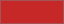 | `#c62828` | the family | Bad: failed, an error or a problem. The red buttons use it too. |
|  | `#b71c1c` | the family | A red button pressed or under the pointer, in the bisect apps and **Clean up logs**. |
|  | `#8b0000` | the family | Active red: a toggle button while its state is on, in BC-250 GPU Manager and BC-250 ACE Queues. It is not an error. |
|  | `#a00000` | the family | Active red under the pointer. |
| 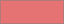 | `#e57373` | text tint | Red text on a dark surface. The check app uses it for findings, the log, in-game checks, history and scores. ACPI, CU Unlock and Core Unlock use it for error labels. SFTP Tools uses it for password advice not followed. |
| 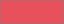 | `#e8505b` | brand or icon | PlayStation's circle, for BC-250 Controller's circle button and DatStation's circle symbol. |
| 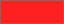 | `#ff2020` | hardware | The light bar's red. The color wheel's red is `#ff0000`. |

### Orange and yellow

| Color | Hex | Kind | Where and why |
| --- | --- | --- | --- |
| 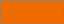 | `#ef6c00` | the family | Warn. |
| 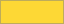 | `#fdd835` | the family | Running. |
| 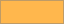 | `#ffb74d` | text tint | Orange text on a dark surface. The check app uses it for warnings, the log, in-game checks and middle scores. SFTP Tools uses it for its password warning. |
| 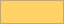 | `#ffd166` | brand or icon | DatStation's PS News symbol. |
| 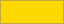 | `#ffd700` | brand or icon | DatStation's gold, for trophies and stars. Its silver is `#c0c0c0` and its bronze `#cd7f32`. |
| 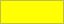 | `#ffff00` | hardware | The color wheel's yellow. |

### Green

| Color | Hex | Kind | Where and why |
| --- | --- | --- | --- |
| 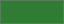 | `#2e7d32` | the family | Ok: passed, valid, unlocked and a pressed controller button. It also marks a right answer. |
| 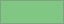 | `#81c784` | text tint | Green text on a dark surface. The check app uses it for log success, in-game ok, a better result in its history and full scores. SFTP Tools uses it for password advice followed. |
| 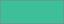 | `#3dbf9c` | brand or icon | PlayStation's triangle, for BC-250 Controller's triangle button and DatStation's triangle symbol. |
| 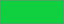 | `#10d040` | hardware | The light bar's green. The color wheel's green is `#00ff00`. |

### Blue

| Color | Hex | Kind | Where and why |
| --- | --- | --- | --- |
|  | `#1565c0` | the family | Info. It also colors the check app's GPU score box and HDMI CEC's adapter and display boxes. |
| 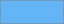 | `#64b5f6` | text tint | Blue text on a dark surface, for the check app's info and hint findings. |
|  | `#0a55b0` | brand or icon | Gaming blue, the gaming apps' color. It is the emulator managers' primary button. The button is `#2a6cc4` under the pointer and `#08448d` pressed. Their links are `#5b93da`. |
|  | `#003791` | brand or icon | PlayStation blue, in DatStation. Its light blue is `#0072ce`. It is `#1a85e0` under the pointer and `#00589f` pressed. Its links are `#4da3ef`. |
| 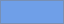 | `#6f9fe8` | brand or icon | PlayStation's cross, for BC-250 Controller's cross button and DatStation's cross symbol. The square is `#e48fc0` in both. |
|  | `#1f3e9c` | brand or icon | BIOS Reader's bar and selection, with `#0b2a8a` and `#10205a`. Together they look like a classic BIOS screen. |
| 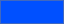 | `#0050ff` | hardware | The light bar's blue, the default. The color wheel's blue is `#0000ff`. |

### Purple

| Color | Hex | Kind | Where and why |
| --- | --- | --- | --- |
|  | `#6a1b9a` | the family | The logo's purple, the suite's own state color. |
| 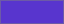 | `#5835ce` | the family | The wiki's purple, with `#8a2be2`. It is the suite's identity on the web. |
| 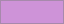 | `#ce93d8` | text tint | Purple text on a dark surface. The check app uses it for log hints, the **Show in log** link and the in-game accent. The overlay uses it for its frame rate and border. |
| 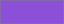 | `#8b4fd8` | the family | The stage pill under the claim on the wiki's home page. |
| 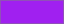 | `#a020f0` | hardware | The light bar's purple. The color wheel's magenta is `#ff00ff`. |

### Palettes of their own

| Color | Hex | Kind | Where and why |
| --- | --- | --- | --- |
| 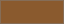 | `#8a5a2e` | brand or icon | Upscaler's copper boxes. Its teal `#0e6f75` boxes and cyan `#26a9b0` outlines go with them. These are the icon's colors. |
|  | `#ad1457` | brand or icon | The check app's System overview, a chart with a color for each series. Cores use this color. Threads use `#00796b`, upload `#3949ab` and NVMe `#6d4c41`. Packages use `#5e35b1`, BIOS `#00838f` and a seventh series `#5d4037`. Each series stands apart from the others. |

## The apps

The theme, the state colors and the style sheets are in `core/bc250_core/theme.py`. Core is bundled per app. The
apps that are not on core yet carry a copy. The user picks one theme, and it holds for every app. The themes are
Gunmetal, Silver and Warm.

### Gunmetal (dark, the default)

Text colors:

- `#d9dde2` Text on every surface.

  

- `#82868b` Muted text: versions, hints, placeholders and disabled buttons. It mixes the text and window colors.

  

- `#ffffff` Text on the accent (selected rows and items).

  

- `#7e97ad` Links.

  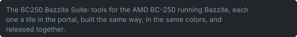

Background colors:

| Color | Hex | Used for |
| --- | --- | --- |
|  | `#2b2f34` | Window and dialog background, and the selected tab. |
|  | `#22262a` | Text fields, lists, tables, tooltips, progress bars and scroll bars. |
|  | `#292d32` | Every other row of a list or table. |
| 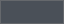 | `#4a5058` | Button face, top of its sheen. Scroll bar handles use it too. |
|  | `#3b4048` | Button face, bottom of its sheen. |
|  | `#606872` | Palette light, the button face 30 % lighter. |
|  | `#14171a` | Borders and shadows. |
| 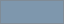 | `#7e97ad` | Accent: selection, progress. |
|  | `#c0c4c9` | Silver outline: the border under the mouse, with the focus and of the chosen tab or item (owner, 05-11-2026). |

### Silver (light)

Text colors:

- `#1e2226` Text on every surface.

  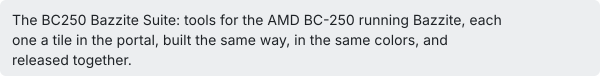

- `#7a7d81` Muted text: versions, hints, placeholders and disabled buttons.

  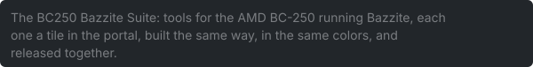

- `#ffffff` Text on the accent.

  

- `#5f7f9c` Links.

  

Background colors:

| Color | Hex | Used for |
| --- | --- | --- |
| 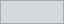 | `#d5d8dc` | Window and dialog background, and the selected tab. |
|  | `#eceef0` | Text fields, lists, tables, tooltips, progress bars and scroll bars. |
|  | `#e2e5e8` | Every other row of a list or table. |
|  | `#eef0f2` | Button face, top of its sheen. Scroll bar handles use it too. |
| 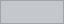 | `#c4c8cd` | Button face, bottom of its sheen. |
|  | `#ffffff` | Palette light, the button face 30 % lighter. |
|  | `#8d9298` | Borders and shadows. |
|  | `#5f7f9c` | Accent: selection, progress. |
|  | `#7d8389` | Silver outline, darker on the light theme. It colors the border under the mouse, the border with the focus and the border of the chosen tab or item. |

### Warm (dark)

Text colors:

- `#e3dfd8` Text on every surface.

  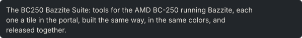

- `#8c8984` Muted text: versions, hints, placeholders and disabled buttons.

  

- `#1b1a18` Text on the accent.

  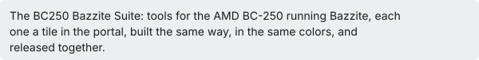

- `#b59a6e` Links.

  

Background colors:

| Color | Hex | Used for |
| --- | --- | --- |
| 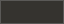 | `#35332f` | Window and dialog background, and the selected tab. |
|  | `#292826` | Text fields, lists, tables, tooltips, progress bars and scroll bars. |
| 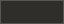 | `#302e2b` | Every other row of a list or table. |
|  | `#57534d` | Button face, top of its sheen. Scroll bar handles use it too. |
| 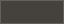 | `#45423d` | Button face, bottom of its sheen. |
|  | `#716c64` | Palette light, the button face 30 % lighter. |
| 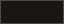 | `#181716` | Borders and shadows. |
|  | `#b59a6e` | Accent: selection, progress. |
|  | `#c0c4c9` | Silver outline: the border under the mouse, with the focus and of the chosen tab or item (owner, 05-11-2026). |

### State colors

A state shows as a colored edge or dot on the theme's surfaces. It looks the same in every theme.

Text colors:

- `#2e7d32` Green: Passed, a valid entry.

  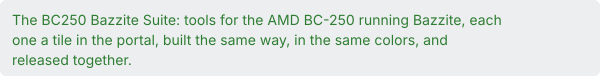

- `#c62828` Red: Failed, errors and problems in every app. Examples are the emulator managers' status lines, the Nexus Release Tool's bad tags, the upscaler's problems and a folder that is missing.

  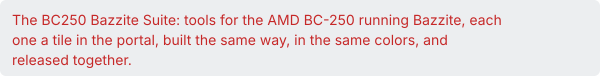

- `#ffffff` Bright text, the palette's BrightText. It is the text on the state colors.

  

Background colors:

| Color | Hex | Used for |
| --- | --- | --- |
|  | `#2e7d32` | Green, ok. It colors a state's edge or dot, an unlocked CU and a pressed controller button. |
|  | `#ef6c00` | Orange, warn. |
|  | `#c62828` | Red, bad. It also colors the red buttons of the bisect apps and **Clean up logs**. |
|  | `#b71c1c` | The red buttons under the pointer or pressed, in the bisect apps and **Clean up logs**. |
|  | `#1565c0` | Blue, info. |
|  | `#3a3f4b` | Gray, neutral. |
|  | `#6a1b9a` | Purple, the logo's purple. |
|  | `#fdd835` | Yellow, running: never confused with a failed (red) state. |
|  | `#8b0000` | Active red: a toggle button while its state is on, in BC-250 GPU Manager and BC-250 ACE Queues. |
|  | `#a00000` | Active red on hover. |
|  | `#424242` | Off: a locked CU, a core without a state. |
|  | `#1d4f91` | Steam artwork: the accent when an icon gives no bright color. |

## The wiki

`docs/stylesheets/suite.css`, Material's slate scheme with the suite's purple.

### Wiki

Text colors:

- `#ffffff` Text in the header, hero, cards and footer. It also colors table headings, the stage pill and the buttons on the dark and accent sections.

  

- `#ffffffb3` Dimmed text on the main and the hover color, for the search field's hint.

  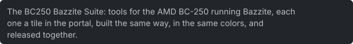

- `#a98bff` Suite soft: links in the dark scheme, hover on the dark section and footer column headings.

  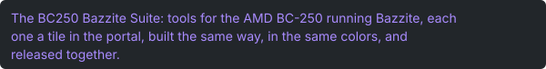

- `#c9bfee` Suite mist: card text and footer links.

  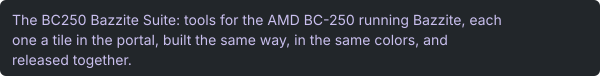

- `#1e1340` Suite deep: a button's text on hover in the dark and accent sections.

  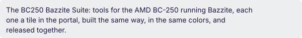

Background colors:

| Color | Hex | Used for |
| --- | --- | --- |
|  | `#5835ce` | Suite primary: Material's primary color, table headings, page icons, the hero and Get started gradients. |
| 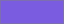 | `#7a5ce0` | Primary, light. |
|  | `#4426a8` | Primary, dark. |
|  | `#8a2be2` | Suite secondary: the accent and the end of the gradients. The accent shows as hover rings on linked images. |
| 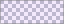 | `#8a2be21a` | The accent at 10 %. |
|  | `#1e1340` | Suite deep: header and tabs, the hero's top, the Download button. |
|  | `#120c22` | Suite ink: the dark section and the home page's footer. |
| 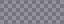 | `#120c2273` | The shadow under the board and the controller at the top of the home page (45 %). |
| 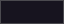 | `#17141f` | Page background (the dark scheme). |
|  | `#8b4fd8` | The stage pill under the claim. |
|  | `#ffffff` | Button background on hover in the dark and accent sections. |
|  | `#ffffff1f` | Behind a link in the header under the pointer (12 %). |
| 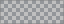 | `#00000040` | The shadow under a button under the pointer (25 %). |
| 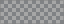 | `#00000059` | The strip with the notice at the bottom of the home page's footer (35 %). |

## The development apps

Nexus's design, in the windows of the apps in `dev/`.

### Nexus Release Tool

The release tool's window takes Nexus's colors as a theme for core's widgets. It sets them with `create_app(theme=NEXUS)`. Its style is in `dev/nrt/nexus_release_tool/style.py`. Its states are the apps' state family.

Text colors:

- `#c0c0c0` Silver: the text, the title, the boxes' values and captions, the buttons, the tabs and the fields.

  

- `#010101` Ink: text on the teal accent (a selected row).

  

Background colors:

| Color | Hex | Used for |
| --- | --- | --- |
|  | `#010101` | Ink: the window, the header, the dialogs and every other row of a table. It is also the bottom of a button's or a box's sheen. |
| 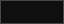 | `#0f0f0f` | Main color: the fields, lists and tables. It is also the top of a button's or a box's sheen. |
| 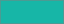 | `#17b6a7` | Teal, the accent. It colors the selection and the outline of a selected cell or a focused field. A button or pill under the pointer takes it too. So do the main actions, such as **Commit**, **Start new release** and **Retract**, and the progress bar. |
|  | `#80808066` | Dimmed silver at 40 %. It colors the borders of the fields, boxes, tabs and buttons, and a box's neutral edge. |

## The apps' own colors

These colors come on top of the theme. They are in each app's `style.py` or in the code that uses them.

### Gaming apps

PS Remote Play, XB Remote Play, BC-250 Controller, PCSX2, PPSSPP, RPCS3, shadPS4, Vita3K and Xenia.

Text colors:

- `#5b93da` Links on a dark window in PS Remote Play, XB Remote Play, PCSX2, PPSSPP, RPCS3, shadPS4, Vita3K and Xenia. BC-250 Controller uses it for its lit parts.

  

- `#ffffff` Text on the blue primary button and on the shortcut artwork.

  

Background colors:

| Color | Hex | Used for |
| --- | --- | --- |
|  | `#0a55b0` | Gaming blue: the primary button and hover borders. It is the gaming apps' color. Their icon has been a silver controller since 13-11-2026. |
|  | `#2a6cc4` | Gaming blue on hover. |
|  | `#08448d` | Gaming blue while pressed. |
| 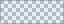 | `#0a55b01a` | Blue tint at 10 %. It colors hover and every other table row. |
|  | `#0a55b059` | Blue line at 35 %. It colors outlines and a pressed button. |
|  | `#80808080` | Disabled (50 % gray). |
|  | `#5b93da` | BC-250 Controller: lit parts of the controller, the chosen card. |
|  | `#0b1d3a` | shadPS4 shortcut artwork, top of the gradient. |
|  | `#030810` | shadPS4 shortcut artwork, bottom. |
|  | `#16123a` | RPCS3 shortcut artwork, top. |
|  | `#05040f` | RPCS3 shortcut artwork, bottom. |
|  | `#0d2a4a` | PPSSPP shortcut artwork, top. |
|  | `#04080f` | PPSSPP shortcut artwork, bottom. |
|  | `#3a2c0d` | Vita3K shortcut artwork, top. |
|  | `#0f0b03` | Vita3K shortcut artwork, bottom. |
|  | `#000000` | PS Remote Play's stream view. |

### DatStation

Text colors:

- `#4da3ef` Links on a dark window.

  

- `#0072ce` Links on a light window.

  

- `#3dbf9c` Triangle: the Quiz symbol. The symbols take the face-button colors, as BC-250 Controller draws them.

  

- `#e8505b` Circle: the History symbol.

  

- `#6f9fe8` Cross: the System Version History symbol.

  

- `#e48fc0` Square: the Region Codes symbol.

  

- `#ffd166` The PS News symbol.

  

- `#ffd700` Gold: the Scores & Trophies symbol, a perfect quiz, gold stars.

  

- `#c0c0c0` Silver stars.

  

- `#cd7f32` Bronze stars.

  

- `#2e7d32` Right answers: the count and the feedback.

  

- `#c62828` Wrong answers: the count. It also shows that little time is left.

  

Background colors:

| Color | Hex | Used for |
| --- | --- | --- |
|  | `#003791` | PlayStation blue. |
|  | `#0072ce` | PlayStation light blue: hover borders. |
|  | `#1a85e0` | Blue on hover. |
|  | `#00589f` | Blue while pressed. |
|  | `#2e7d32` | A right answer's button. |
|  | `#c62828` | A wrong answer's button. |

### Upscaler

Text colors:

- `#3fc8cf` Links on a dark window.

  

- `#0e6f75` Links on a light window.

  

Background colors:

| Color | Hex | Used for |
| --- | --- | --- |
|  | `#8a5a2e` | Copper: boxes, white text on them. |
|  | `#0e6f75` | Teal: boxes, white text on them. |
|  | `#26a9b0` | Cyan, the icon's: button outlines. |

### BC-250 Board Test (check)

Text colors:

- `#9aa0a6` Muted: versions, hints, notes, baselines, the in-game and overlay labels.

  

- `#e6e6e6` Text in the results and history views, on idle buttons, the overlay's values.

  

- `#e8e8e8` Code blocks in the README view.

  

- `#d0d0d0` The log, and a disabled **Clean up logs** button.

  

- `#1a1a1a` Text on the yellow running button.

  

- `#222222` Text on the system score boxes.

  

- `#333333` Labels on the graph's bars.

  

- `#e57373` Error findings, a worse result in the history, a low score and the log's errors. It also colors error labels and the in-game error. ACPI, CU Unlock and Core Unlock use it for error labels too.

  

- `#ffb74d` Warning findings, a middle score, the log's warnings and the in-game warning.

  

- `#64b5f6` Info and hint findings.

  

- `#81c784` A better result in the history, the log's success, a full score and the in-game ok.

  

- `#fdd835` A score's warning, in the running yellow.

  

- `#ce93d8` The log's hints, the **Show in log** link and the in-game accent. The overlay uses it for its frame rate and thin border.

  

- `#90a4ae` Log: note.

  

- `#ffffff` README table headings.

  

Background colors:

| Color | Hex | Used for |
| --- | --- | --- |
|  | `#111418` | The log and the overlay's background at 82 %. |
|  | `#1e1f24` | The results and history views, and code blocks in the README view. |
|  | `#14161c` | The results card and the score dialog. |
|  | `#2a2d36` | The empty part of a score ring. |
|  | `#2a2f37` | The log's border. |
|  | `#3a3f4a` | The borders of the preview, setup, checks and stat cards. |
|  | `#555555` | The screenshot's border. |
|  | `#888888` | README table borders. |
|  | `#3a3f4b` | Idle buttons, README table headings and a disabled **Clean up logs** button. |
|  | `#b71c1c` | Clean up logs under the pointer and pressed. |
|  | `#f8fafc` | The system score boxes. |
|  | `#1565c0` | The GPU score box, in the info blue. |
|  | `#ad1457` | System overview: cores. |
|  | `#00796b` | System overview: threads. |
|  | `#3949ab` | System overview: upload speed. |
|  | `#6d4c41` | System overview: NVMe. |
|  | `#5e35b1` | System overview: packages. |
|  | `#00838f` | System overview: BIOS. It is also the graph's sixth series. |
|  | `#5d4037` | The graph's seventh series. |

### Other apps

Text colors:

- `#888888` Busy and hint labels in italics (ACPI).

  

- `#ef6c00` An incomplete ACPI override, and a CU mask that needs checking.

  

- `#b8b8c8` System Overlay: the names of the values.

  

- `#dddddd` PS Remote Play's stream view.

  

- `#ffb74d` SFTP: the password warning.

  

- `#e57373` SFTP: password advice not followed.

  

- `#81c784` SFTP: password advice followed.

  

- `#ffffff` BIOS Reader: tabs, crumbs, the legend and the selection.

  

- `#0b2a8a` BIOS Reader: the screen's text.

  

- `#10205a` BIOS Reader: subtitles.

  

- `#6e6e6e` BIOS Reader: hidden items.

  

- `#7d7d8c` BIOS Reader: locked items.

  

- `#2e7d32` Installer Tests: passed.

  

Background colors:

| Color | Hex | Used for |
| --- | --- | --- |
|  | `#1f3e9c` | BIOS Reader: the bar and the selection. |
|  | `#c6c6c6` | BIOS Reader: the screen. |
|  | `#1565c0` | HDMI-CEC: the adapter and display boxes. |
|  | `#000000` | BC-250 Controller: the light bar off. |
|  | `#c62828` | SFTP: the errors button. |
|  | `#5f6368` | VRAM: firmware in the memory map. |
|  | `#00838f` | VRAM: zswap in the memory map. |
|  | `#3dbf9c` | BC-250 Controller: the triangle button. |
|  | `#e8505b` | BC-250 Controller: the circle button. |
|  | `#6f9fe8` | BC-250 Controller: the cross button. |
|  | `#e48fc0` | BC-250 Controller: the square button. |
|  | `#0050ff` | BC-250 Controller: the light bar's blue, the default. |
|  | `#ff2020` | Light bar: red. |
|  | `#10d040` | Light bar: green. |
|  | `#a020f0` | Light bar: purple. |
|  | `#ffffff` | Light bar: white. |
|  | `#ff0000` | The color wheel's red, for the light bar. |
|  | `#ffff00` | Color wheel: yellow. |
|  | `#00ff00` | Color wheel: green. |
|  | `#00ffff` | Color wheel: cyan. |
|  | `#0000ff` | Color wheel: blue. |
|  | `#ff00ff` | Color wheel: magenta. |
|  | `#04060c` | Portal: the intro's backdrop. |
|  | `#1b1b1b` | Portal: the outline of the update badge on a tile. |
|  | `#808080` | Portal: a category tab on hover (16 %). |

## Tools

### Portal screenshots

`tools/portal_screenshot.py` paints the portal in a fixed dark palette, so screenshots look the same on every machine. The palette is Breeze Dark, as Bazzite's desktop shows the portal.

Text colors:

- `#fcfcfc` Window, field, button and tooltip text.

  

- `#a1a9b1` Placeholders.

  

- `#1d99f3` Links.

  

Background colors:

| Color | Hex | Used for |
| --- | --- | --- |
|  | `#202326` | Window. |
|  | `#141618` | Fields and lists. |
|  | `#1d1f22` | Every other row. |
|  | `#292c30` | Buttons and tooltips. |
|  | `#3daee9` | Selection. |
|  | `#43474d` | Mid. |
|  | `#33373b` | Midlight. |
|  | `#101113` | Dark. |
|  | `#3d4146` | Light. |

## Icons

Every icon of the suite and where it is used. `tools/design_icons.py` reads most of this from the repository, so it stays current.

### The suite's icon

| Icon | File | Used for |
| --- | --- | --- |
|  | `portal/images/bc250-bazzite-suite.webp` | The portal's header (a click opens the wiki), its window icon and its tray icon. |
|  | `portal/images/bc250-bazzite-suite-1024.webp` | The portal's intro. |
|  | `portal/images/bc250-bazzite-suite-128.png` | The portal's menu entry and Desktop icon. |
|  | `portal/images/apps/portal.webp` | The portal's own tile. |
|  | `docs/images/wiki-icon.webp` | The wiki's header logo, its home page's footer and its favicon (with the .png). |
|  | `dev/nrt/images/nexus-release-tool.webp` | Every development app's icon in dev/<name>/images/: the Nexus drawing, as Nexus's apps have it. |

### The category icons

Every app has the icon of its category. `icons/categories.toml` assigns them, and `tools/sync_icons.py` copies each category's icon from `icons/<category>/` to the app's `images/`, the portal's `images/apps/` and `images/categories/`, and the wiki. The wiki's App categories page shows each app with its icon.

| Icon | Category | Apps |
| --- | --- | --- |
|  | Gaming | BC-250 PS Remote Play (`consoles`) BC-250 XB Remote Play (`clb`) Bazzite DatStation (`datstation`) PCSX2 Manager (`pcsx2`) PPSSPP Manager (`ppsspp`) RPCS3 Manager (`rpcs3`) Vita3K Manager (`vita3k`) Xenia Manager (`xenia`) shadPS4 Manager (`shadps4`) |
|  | Graphics | BC-250 ACE Queues (`ace`) BC-250 Mesh Shaders (`mesh`) BC-250 Upscaler Manager (`upscaler`) |
|  | Sustainable | BC-250 Board Test (`check`) BC-250 CU Unlock (`compute`) BC-250 Core Unlock (`cores`) BC-250 Fan Control (`fan`) BC-250 GPU Manager (`gpu`) BC-250 Memory Manager (`vram`) BC-250 Persistent ACPI (`acpi`) |
|  | Utilities | BC-250 BIOS Reader (`bios`) BC-250 Bluetooth Pairing (`btpair`) BC-250 CEC Manager (`cec`) BC-250 Controller (`controller`) BC-250 Password Generator (`password`) BC-250 Quickfix (`quickfix`) BC-250 SFTP Tools (`sftp`) BC-250 SSD Check (`ssd`) BC-250 System Overlay (`overlay`) BC-250 Turing Screen (`turing`) BC-250 Webcam (`webcam`) |

### The portal's symbols

Drawn with QPainter in the portal's `glyphs.py`, in the theme's text color. Each function draws one.

| Name | What it shows |
| --- | --- |
| `install` | An arrow down into a tray. |
| `reinstall` | A circular arrow. |
| `uninstall` | A waste bin. |
| `refresh` | Two arrows that chase each other around a circle. |
| `chip` | A processor: a square with pins on every side. |
| `install_apps` | Three apps of a grid of four, an arrow down in the place of the fourth. |
| `install_updates` | A circular arrow around an arrow down. |
| `menu` | ☰: three bars. |
| `close` | A cross: the portal's exit. |
| `steam` | Steam: a disc with a piston's rod cut out of it, a large ring at its head and a small one at its foot. |
| `folder` | A folder: the file manager. |
| `youtube` | A screen with a play triangle. |
| `github` | GitHub: a disc with a cat cut out of it, its head with two ears, its body and its tail. |
| `bluetooth` | The Bluetooth rune. |
| `network` | Three arcs over a dot: the network. |
| `volume` | A loudspeaker with two waves of sound: the volume. |
| `screen` | A screen on its foot: the display. |

### The desktop style's icons

Icons the apps take from the desktop's style or icon theme, so they look different on every desktop. The name is Qt's standard pixmap or the icon theme's name.

| Name | Used by |
| --- | --- |
| `SP_BrowserReload` | Nexus Deps |
| `SP_MessageBoxInformation` | BC-250 Board Test, Nexus Deps |
| `SP_MessageBoxWarning` | BC-250 Board Test |
| `view-refresh` | Nexus Deps |

### Material Design icons in the wiki

Drawn by MkDocs Material in the wiki's colors.

| Icon | Name | Pages |
| --- | --- | --- |
|  | `material-chip` | What is the BC-250? |
|  | `material-clipboard-check-outline` | Board Test: the script |
|  | `material-clipboard-list-outline` | Basic tests and additional requirements to streamline the Qt GUI version |
|  | `material-code-braces` | Development |
|  | `material-cog-outline` | BC-250 Board Test - development |
|  | `material-download` | Tools for every part of the board. { .home-hero__lead } |
|  | `material-expansion-card` | Tools for every part of the board. { .home-hero__lead } |
|  | `material-eye-off-outline` | Privacy |
|  | `material-gamepad-variant` | Tools for every part of the board. { .home-hero__lead } |
|  | `material-github` | GitHub settings |
|  | `material-image-multiple-outline` | Covers from SteamGridDB |
|  | `material-linux` | What is Bazzite? |
|  | `material-lock-open-variant` | Tools for every part of the board. { .home-hero__lead } |
|  | `material-memory` | Memory Manager internals |
|  | `material-play-circle-outline` | Portal Tour |
|  | `material-shape-outline` | App categories |
|  | `material-shield-lock-outline` | Security |
|  | `material-sitemap-outline` | Architecture and consistency |
|  | `material-speedometer` | Tools for every part of the board. { .home-hero__lead } |
|  | `material-stethoscope` | Tools for every part of the board. { .home-hero__lead } |
|  | `material-tag-outline` | Releases |
|  | `material-television` | Tools for every part of the board. { .home-hero__lead } |
|  | `material-tray-arrow-down` | Install |
|  | `material-video-wireless-outline` | PS Remote Play: the stream's threads |
|  | `material-view-dashboard-outline` | Dashboard |
|  | `material-view-grid-outline` | The apps |

### Characters as icons

Characters of the font that the apps use as icons in labels and buttons.

| App | Characters |
| --- | --- |
| Portal | ● ☰ |
| BC-250 BIOS Reader | ▶ ↓ ↑ ← › |
| BC-250 Board Test | ✔ ✖ ✕ ⚠ ▶ ■ ↓ ↑ › 💡 🎮 |
| BC-250 CU Unlock | ■ |
| BC-250 Controller | ✓ ✕ › △ ○ □ |
| BC-250 Core Unlock | ✔ ✖ ▶ ■ |
| BC-250 GPU Manager | ✔ ✖ ⚠ ▶ ● |
| BC-250 PS Remote Play | ✓ ✗ |
| BC-250 Persistent ACPI | ● |
| BC-250 Quickfix | ● ○ |
| BC-250 SFTP Tools | ✓ ✗ ⚠ ↓ ↑ ← |
| BC-250 System Overlay | ↓ ↑ |
| BC-250 Turing Screen | ↓ ↑ |
| BC-250 Webcam | ✓ ● |
| Bazzite DatStation | ← △ ○ □ ◇ ◆ ★ |
| Every app on core | ✓ ● ↻ |
| Nexus Deps | ✓ ✗ |
| Nexus Installer Tests | ✓ ✗ |
| Nexus Release Tool | ✓ ▶ ● ↓ ↑ |
