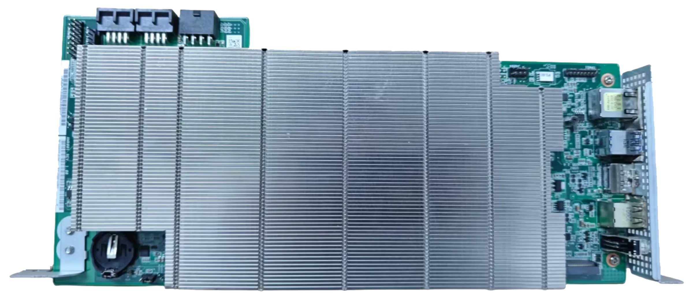
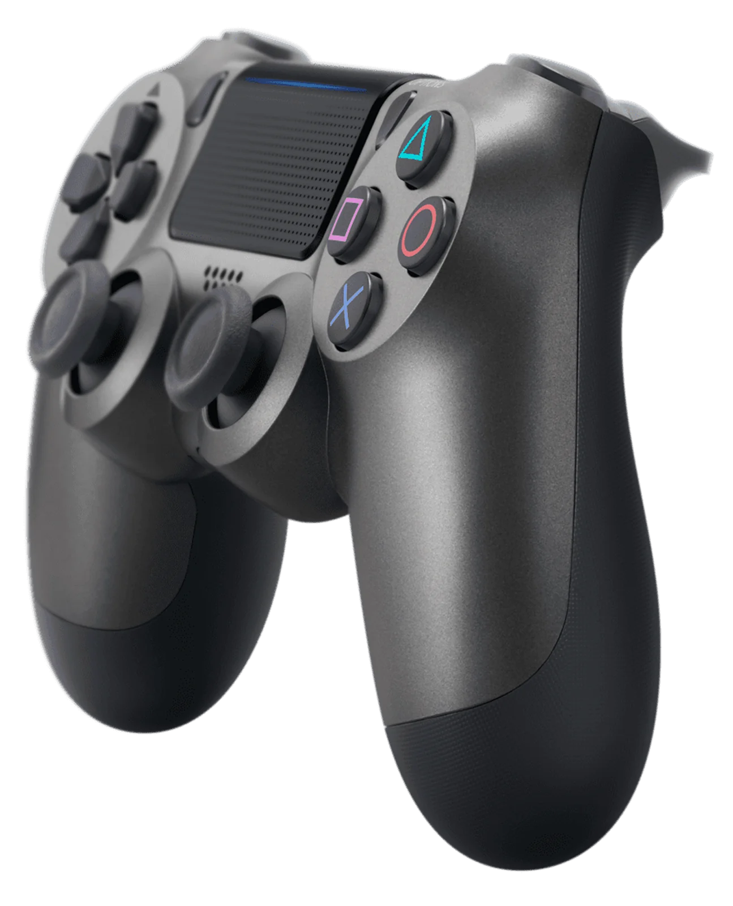
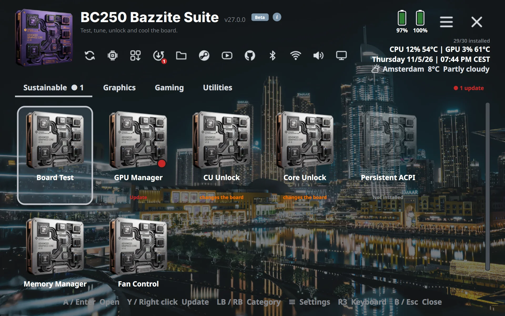

<!-- SPDX-License-Identifier: GPL-3.0-or-later -->

<section class="home-hero" markdown>

{ .home-hero__board }
{ .home-hero__controller }

# Tools for every part of the board. { .home-hero__lead }

Get the most out of your BC-250.

<strong>Beta</strong> The suite is in active development. Features and layout may still change between releases.

</section>

<section class="home-section home-section--dark" markdown>

## What's in the suite?

#### :material-stethoscope: Diagnostics

[Board Test](apps/check.md) checks, stress-tests and benchmarks the board.
[Quickfix](apps/quickfix.md) sets up Board Test's optional tools, MangoHud's FPS log, the GPU metrics, the sensors
and the journal. [BIOS Reader](apps/bios.md) shows every BIOS setting, hidden menus too.
[BC-250 System Overlay](apps/overlay.md) shows CPU, GPU, fan and temperatures in a window that stays on top.
[Turing Screen](apps/turing.md) shows them on a small USB screen.
[Fan Control](apps/fan.md) guards the board against overheating.

#### :material-speedometer: Tuning

[GPU Manager](apps/gpu.md) tunes the GPU governor. Its GPU sweep finds your board's safe overclock and undervolt.
[Persistent ACPI](apps/acpi.md) gives the CPU its C-states and frequency scaling.

#### :material-lock-open-variant: Unlocks

[CU Unlock](apps/compute.md) and [Core Unlock](apps/cores.md) tell bad CUs and cores apart from an
unstable unlock. [Memory Manager](apps/vram.md) sets the VRAM split.

#### :material-expansion-card: Graphics

[BC-250 Upscaler Manager](apps/upscaler.md) puts an FSR 3.1 drop-in upscaler into games.
[ACE Queues](apps/ace.md) and [Mesh Shaders](apps/mesh.md) bring async compute and mesh shaders.
They work beside the system Mesa.

#### :material-gamepad-variant: Gaming

[shadPS4 Manager](apps/shadps4.md) plays PS4 games with the shadPS4 emulator.
[RPCS3 Manager](apps/rpcs3.md) plays PS3 games with the RPCS3 emulator.
[PPSSPP Manager](apps/ppsspp.md), [PCSX2 Manager](apps/pcsx2.md), [Vita3K Manager](apps/vita3k.md) and
[Xenia Manager](apps/xenia.md) bring the PSP, PS2, PS Vita and Xbox 360 emulators.
[BC-250 PS Remote Play](apps/consoles.md) finds, wakes and registers PS4 and PS5 consoles for Remote Play.
[BC-250 XB Remote Play](apps/clb.md) streams from an Xbox.
[Bazzite DatStation](apps/datstation.md) is a PlayStation reference.

#### :material-television: Living room

[BC-250 CEC Manager](apps/cec.md) turns the TV on and off with the board.
[SFTP Tools](apps/sftp.md) moves files between computers.
[Webcam](apps/webcam.md) makes the PS5 HD Camera a webcam.
[Controller](apps/controller.md) updates the DualSense's firmware.
[Bluetooth Pairing](apps/btpair.md) pairs your Bluetooth keyboard, mouse and controllers at every boot.
[SSD Check](apps/ssd.md) checks a drive's health and speed.
[Password Generator](apps/password.md) makes a random password and keeps it nowhere.

[All the apps](apps/index.md){ .md-button }

</section>

<section class="home-section home-section--light" markdown>

## One dashboard for all the apps

The portal installs, opens, updates and removes the apps. It runs fullscreen, and you use it with the keyboard,
the mouse or a controller. Each app is a tile. Press a tile to open its app. The tile's menu installs or removes the
app. A red dot shows an update. The portal marks the apps that **change the board**. It asks before it installs or
opens them.

[About the portal](portal.md){ .md-button }

{ .home-split__picture }

</section>

<section class="home-section home-section--accent" markdown>

## Get started

Ready to set up your BC-250 board? Download the newest portal on the board.
It is the latest release on GitHub.
Check it with SHA256 and run its installer. The installer also installs BC-250 Board Test and BC-250 Quickfix. Each
fix of Quickfix, such as MangoHud Config, Fix GPU Metrics or Sensors Module, is a tile on Utilities. Every other app
installs from the portal.

[:material-download: Download](https://github.com/RobertoTorino/bc250-bazzite/releases/latest){ .md-button .md-button--primary }
[Install steps](install.md){ .md-button }

</section>

<section class="home-section home-faq" markdown>

## FAQ

### Do the apps change my board?

Only the apps marked **changes the board** do. These are the apps for:

- the unlocks
- the GPU governor
- GPU overclocking
- the ACPI override
- the VRAM split
- the thermal guard
- the patched GPU drivers

Most of Quickfix's fixes are marked too. These changes are all software-only, and you can undo them. The portal
asks before it installs or opens such an app. The chapter of each such app opens with a **Changes the board** box.
It says what the app touches and what stays after a restart or a power off. It says what the app never touches, such
as the BIOS or the firmware. It also says how you undo the change. The portal shows the same text when you hover over
the tile. BC-250 Board Test and BIOS Reader only read.

### How do I undo a change?

You undo it in the app that made it. Each of these apps has an Uninstall, Remove, Undo or Turn off. Removing an app
does not undo what it changed on the board. So undo the change first.
[What stays after an uninstall](portal.md#what-stays-after-an-uninstall) lists each app and how to undo it.

### Do the apps change Bazzite's own driver?

No. ACE Queues and Mesh Shaders build their RADV beside the system Mesa, which stays as it is, and games use it
only when you say so. Bazzite's own packages and their updates are Bazzite's.

### Do I have to install the apps one by one?

No. You install the portal, and the portal installs, updates and removes the apps. It takes each app from a tested
release. It checks that release before it unpacks it. See [Install](install.md).

### Does it work on other boards or systems?

The suite is made for the AMD BC-250 running Bazzite, and tested on it.

### How do I check a download?

Every release comes with a `SHA256SUMS` file. Run `sha256sum --check --ignore-missing SHA256SUMS` before you
install. See the [security policy](SECURITY.md#verifying-a-download).

### Is it open source?

Yes. The code of every app is on [GitHub](https://github.com/RobertoTorino/bc250-bazzite), under the licenses
below.

### What does the suite know about me?

Nothing that it sends anywhere. It has no accounts, statistics or crash reports. What goes over the network, and
when, is on the [Privacy](privacy.md) page.

### Where do I get help?

Open an issue on [GitHub](https://github.com/RobertoTorino/bc250-bazzite/issues). For a security problem,
use **Security → Report a vulnerability** instead, as the [security policy](SECURITY.md) says.

## License

The suite is under GPL-3.0-or-later, with two exceptions. BC-250 Persistent ACPI is under MIT. BC-250 PS Remote Play
is under AGPL-3.0, because its protocol code comes from chiaki-ng. Each app has its own `LICENSE`.

Generative AI tools made the icons, and they were then edited by hand in Photoshop. Generative AI tools also made the
music of the video tours. The portal's welcome sound comes from Nexus Remix Studio, with a voice that Nexus TTS
generated. The other sounds were made without AI:

- the portal's intro sound, which its own code makes from arithmetic alone
- the portal's sound on a controller action, made by hand in Audacity
- DatStation's quiz music, made by hand in Audacity

They are all under the license of the app or tool they come with, like its code.

</section>
